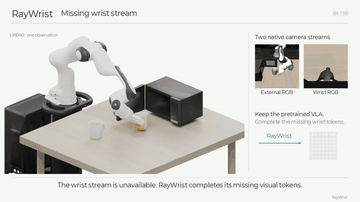

<div align="center">

## RayWrist: Geometry-Guided Wrist-Token Completion<br>for Frozen Vision-Language-Action Models

**Seunghun Baek<sup>\*</sup> · Minjae Lee<sup>\*</sup> · Won Hwa Kim**  
<sup>* Equal contribution.</sup>

[](https://arxiv.org/abs/XXXX.XXXXX)
[](#installation)
[](docs/gr00t.md)
[](docs/openpi.md)
[](#method)
[](#license)

**[📄 Paper](https://arxiv.org/abs/XXXX.XXXXX) · [🎬 Full Video](overview.mp4) · [🛠️ Installation](#installation) · [🤖 RoboCasa](#robocasa) · [📚 Citation](#citation)**

[](overview.mp4)

<sub>Full method overview · Click to watch with audio.</sub>

</div>

---

<a id="method"></a>

## ✨ Method

**RayWrist completes missing wrist tokens while keeping the pretrained visual encoder and policy frozen.** A tool-centered crop from the retained external RGB view supplies contextual queries and a 3D tool-frame feature grid. A learned readout samples this grid along nominal wrist-camera rays and writes completed tokens into the policy's native visual interface.

Deployment uses retained RGB observations, physical robot state, and camera calibration. Retained views follow their original path, and independent wrist adapters can be enabled as needed. We also study joint head-camera-only learning on RoboCasa, where readers and the native action fine-tuning scope are optimized together.

<a id="installation"></a>

## 🛠️ Installation

Use the official environment for each backbone, then install RayWrist in that environment. The source revisions and interface files are pinned in [`configs/upstream.json`](configs/upstream.json).

| Backbone | Official source | Python | Guide |
| --- | --- | --- | --- |
| GR00T N1.7 | [Isaac-GR00T `d2b7e75`](https://github.com/NVIDIA/Isaac-GR00T/tree/d2b7e75b937e3ec9aa5dbc798f08b89692c49734) | 3.12 | [Installation and use](docs/gr00t.md) |
| π₀.₅ | [OpenPI `215abfb`](https://github.com/Physical-Intelligence/openpi/tree/215abfb217dbac7d5f1273282331b9b1866c0479) | 3.11 | [Installation and use](docs/openpi.md) |

For a standalone reader example:

```bash
python -m pip install -e '.[torch,test]'
python examples/torch_reader.py
```

For the JAX reader, use `'.[jax,test]'` and `python examples/jax_reader.py` in a separate environment.

<a id="usage"></a>

## 🚀 Using RayWrist

For each missing wrist, build a tool-centered crop from the retained view and compute geometry from the physical state. Encode the crop with the frozen native encoder, apply the reader, and write its output into the corresponding native wrist-feature slot. Available views, image order, language processing, and action generation keep their original interfaces.

- **GR00T:** [`GrootRayWrist`](src/raywrist/integrations/gr00t.py) completes the merged feature and three DeepStack streams at the existing Qwen3-VL interface. It also extracts the unmerged block-5 raster for the grid.
- **π₀.₅:** [`OpenPIRayWrist`](src/raywrist/integrations/openpi.py) uses the native SigLIP outputs, prefix masks, action objective, and Euler sampler. Each missing wrist has a separate reader parameter tree.
- **Geometry:** [`src/raywrist/geometry`](src/raywrist/geometry) contains the LIBERO, RoboTwin, RoboCasa, and SO-101 constructions. Camera calibration and preprocessing affines use the same coordinates as the images supplied to the encoder.

The backbone guides contain loading, inference, and training examples. Pretrained backbone checkpoints and benchmark datasets are obtained from their official sources.

<a id="robocasa"></a>

## 🤖 Head-Camera-Only Learning on RoboCasa

RayWrist also supports joint policy learning when the dataset provides head RGB without wrist cameras. On RoboCasa GR1 Tabletop, physical end-effector poses select two local crops from the head view. Independent left and right readers lift these features into their tool-frame grids and produce virtual-wrist tokens alongside the retained head-view tokens.

We train both readers with GR00T's native projector and action modules for 30,000 updates, keeping vision and language frozen. This setting uses the native action objective without a wrist-image teacher.

| Method | Successes across 24 tasks | Success rate |
| --- | ---: | ---: |
| Native head-only FT | 394 / 1,200 | 32.83% |
| FT + RayWrist | 453 / 1,200 | **37.75%** |

The paper evaluates 50 episodes per task and reports a **4.92-point improvement**. The [RoboCasa guide](docs/robocasa.md) covers native preprocessing, virtual-wrist geometry, joint training, checkpoint loading, inference, and the task-level breakdown.

```bash
torchrun --standalone --nproc-per-node=4 scripts/train_robocasa.py \
  --base-model /path/to/native_gr00t_n17_base \
  --dataset-root /path/to/prepared_gr1_tabletop \
  --output-dir runs/robocasa_raywrist
```

The [configuration](configs/robocasa_gr1.json) lists all 24 task directories and the paper's training and evaluation settings. Add `--baseline` to train native head-only FT with the same budget.

<a id="training"></a>

## 🏋️ Training

Missing-view adaptation optimizes the adapter with the native action objective and full-view conditioning alignment. The teacher uses paired wrist RGB during training and is detached. Alignment is applied at the recipient's native conditioning interface over valid conditioning tokens.

| Setting | Updates | Global batch | Peak learning rate | Trainable scope |
| --- | ---: | ---: | ---: | --- |
| π₀.₅, LIBERO / RoboTwin | 10,000 | 256 | 5e-5 | Wrist readers |
| GR00T N1.7, LIBERO | 10,000 | 640 | 1e-4 | Wrist reader |
| GR00T N1.7, SO-101 | 10,000 | 32 | 1e-4 | Wrist readers |
| GR00T N1.7, RoboCasa | 30,000 | 512 | 1e-4 | Wrist readers and native action fine-tuning scope |

All GR00T LIBERO suites share the listed recipe and use their suite-specific recipient and data. RoboCasa uses action supervision without a wrist-image teacher. See [training details](docs/training.md) and the complete [training configurations](configs/training_recipes.json) for schedules, precision, writer initialization, and checkpoint selection.

<a id="tests"></a>

## 🧪 Tests

```bash
CUDA_VISIBLE_DEVICES="" JAX_PLATFORMS=cpu python -m pytest -q
```

Tests cover geometry, native feature insertion, reader gradients, null handling, and conditioning alignment. Each backend is optional; tests for a backend that is not installed are skipped.

<a id="citation"></a>

## 📚 Citation

If this repository is useful for your research, please cite:

```bibtex
@misc{baek2026raywrist,
  title         = {RayWrist: Geometry-Guided Wrist-Token Completion for Frozen Vision-Language-Action Models},
  author        = {Baek, Seunghun and Lee, Minjae and Kim, Won Hwa},
  year          = {2026},
  archivePrefix = {arXiv},
  eprint        = {XXXX.XXXXX},
  url           = {https://arxiv.org/abs/XXXX.XXXXX}
}
```

<a id="acknowledgements"></a>

## 🤝 Acknowledgements

Built on [Isaac-GR00T](https://github.com/NVIDIA/Isaac-GR00T) and [OpenPI](https://github.com/Physical-Intelligence/openpi), with [LIBERO](https://github.com/Lifelong-Robot-Learning/LIBERO), [RoboTwin](https://github.com/RoboTwin-Platform/RoboTwin), and [RoboCasa](https://github.com/robocasa/robocasa).

<a id="license"></a>

## 📜 License

The code is released under [Apache-2.0](LICENSE). See [NOTICE](NOTICE) for attribution. Backbone weights and datasets retain their original licenses.
